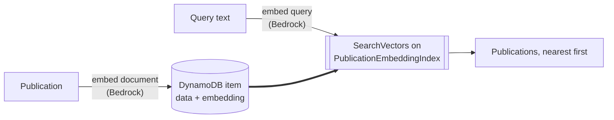

# dynamodb-vector-search

Semantic search over publications, using a DynamoDB vector index and Cohere embeddings on Amazon Bedrock.

## How it works



## What gets embedded

`PublicationEmbedder` flattens a publication into four labelled lines, and that whole block becomes one vector:

```
Title: Sea ice thickness in the Barents Sea from four decades of satellite altimetry
Description: A reanalysis of radar altimetry records showing an accelerating thinning trend north of Svalbard...
Contributors: Kari Nystuen; Lars Eide
Institutions: Institute of Marine Research
```

The stored item keeps the data and the vector side by side:

```
PK0        PUBLICATION#b7cc17ee-1ca6-4a9a-bdbb-f7f22f9a6706
SK0        PUBLICATION
data       {"title":"Sea ice thickness...","description":"...","contributors":[{"name":"Kari Nystuen",...}]}
embedding  [0.0213, -0.1451, 0.0772, ...]   1024 numbers
```

The index `PublicationEmbeddingIndex` is defined over `embedding` with `COSINE` distance and projects `data`,
so a search returns everything needed to rebuild the publication without a second read.

## Prerequisites

- **Java 25** — Gradle provisions the toolchain, so a different local JDK is fine.
- **AWS credentials** — `aws sso login --profile <profile>`, then `export AWS_PROFILE=<profile>`. SSO profiles
  resolve because `build.gradle` puts the `sso` and `ssooidc` modules on the runtime classpath. If
  `InvalidClientTokenId` survives a login, stale environment variables are outranking the profile:
  `unset AWS_ACCESS_KEY_ID AWS_SECRET_ACCESS_KEY AWS_SESSION_TOKEN`.
- **A region offering DynamoDB vector indexes** — the examples use `eu-west-1`.
- **Bedrock model access** for `cohere.embed-multilingual-v3`, granted per region in the Bedrock console.
- **Permissions**: `dynamodb:PutItem`, `dynamodb:GetItem`, `dynamodb:SearchVectors`, `bedrock:InvokeModel`.

## Deploy

```bash
aws cloudformation deploy --template-file template.yaml \
  --stack-name dynamodb-vector-search --region eu-west-1
```

The vector index builds asynchronously — wait for `ACTIVE` before searching, or results come back empty:

```bash
aws dynamodb describe-table --table-name publications --region eu-west-1 \
  --query "Table.VectorIndexes[0].[IndexName,IndexStatus]"
```

The table is `publications`.

## Run

```bash
AWS_PROFILE=<profile> ./gradlew run -q --console=plain --args="melting ice in the far north"
```

Each run indexes all ten publications from `src/main/resources/publications.json`, then searches. Indexing is
silent, so the query is the first line of output:

```
Searching for: melting ice in the far north
b7cc17ee-1ca6-4a9a-bdbb-f7f22f9a6706  Sea ice thickness in the Barents Sea from four decades of satellite altimetry
07e5ea6c-555e-488e-ae1e-6481fabe5ef8  Fatigue cracking in monopile foundations for offshore wind
...
```

A query is required; without one it prints usage and does nothing. Identifiers are fixed, so re-running
overwrites the same ten items. Each run costs eleven Bedrock calls: one per publication, one for the query.

## Test that it works

The ten publications cover unrelated subjects, so semantic matching shows when a query shares no word with the
title it finds. All four were run against a deployed stack:

| Query | First hit |
| --- | --- |
| `how do radiologists use neural networks` | Tumour detection in mammography screening |
| `melting ice in the far north` | Sea ice thickness in the Barents Sea |
| `fish farming disease` | Sea lice resistance in farmed Atlantic salmon |
| `old handwriting on parchment` | Scribal hands in Icelandic manuscripts |

Two pairs put the same signal in different places — once in a title, once in a structured field — to show
which position the embedding favours. The title wins both times:

| Query | First hit | Next |
| --- | --- | --- |
| `Ingrid Halvorsen` | *...field notes on alpine botany in Jotunheimen* — the name is in the title | *Deep learning for tumour detection* — the same name as a contributor |
| `SINTEF` | *A history of SINTEF and the postwar industrial laboratories* — in the title | *Fatigue cracking in monopile foundations* and *Approximate nearest neighbour search* — SINTEF Digital as institution |

The structured lines are not ignored, though: in both runs the publications carrying the name or institution
only in `Contributors:` or `Institutions:` came straight after the title match, ahead of every unrelated
subject. Position changes the ranking, not whether the field counts.

**Every publication comes back on every search**, ranked nearest first — `topK` is 100 and the scores are
discarded, so nothing is filtered out. Read the top of the list, not its length.

Check what was stored:

```bash
aws dynamodb scan --table-name publications --region eu-west-1 --select COUNT
```

### Unit tests

```bash
./gradlew build
```

No AWS account needed: persistence runs against embedded DynamoDB Local, Bedrock and `SearchVectors` against
recording fakes. DynamoDB Local does not serve vector indexes, so the tests cover how the search request is
built and how its results are mapped — not the ranking itself.

## Tear down

```bash
aws cloudformation delete-stack --stack-name dynamodb-vector-search --region eu-west-1
```

The table and everything in it goes with the stack.
